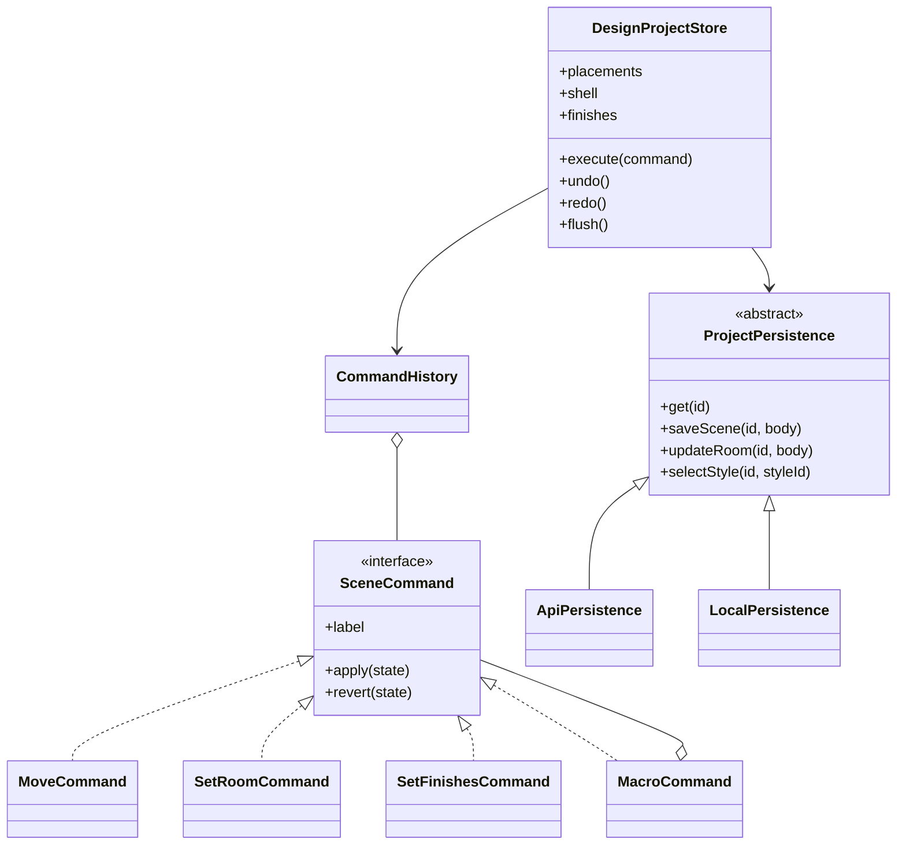
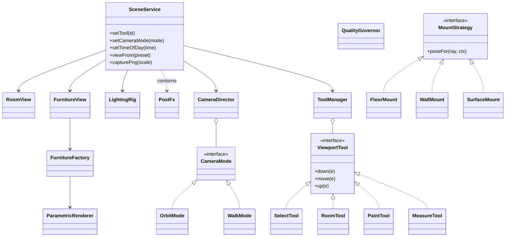
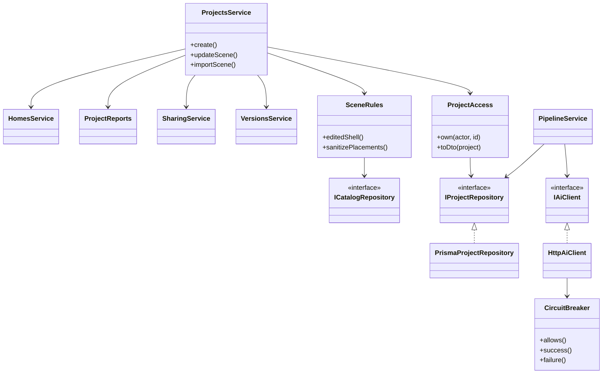
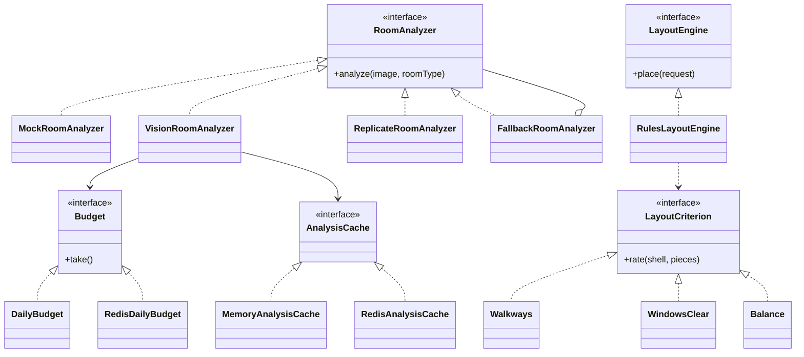

# Diagrama de clases y patrones

Las clases que sostienen el diseño, agrupadas por el patrón que aplican. No están todas: están las
que explican cómo está hecha la app. Los nombres son los del código.

## 1. Editor: estado, comandos y dónde se guarda

- **Command** — toda edición es un `SceneCommand`: por eso todo se deshace. `MacroCommand`
  (**Composite**) junta varias en un solo paso ("Otra distribución", "Vaciar cuarto").
- **Strategy** — `ProjectPersistence`: con cuenta el proyecto vive en la API; en la demo, en el
  navegador. El editor no sabe cuál usa.

## 2. Visor 3D: una fachada y sus piezas

- **Facade** — `SceneService` es la única puerta de Angular a three.js.
- **State** — `ToolManager` entrega cada gesto a la herramienta activa; `CameraDirector`, a su modo.
- **Strategy** — `MountStrategy` decide dónde cae un mueble según se apoye en el piso, la pared u
  otro mueble; `LightingPreset` (día, tarde, noche) decide cómo se ilumina.
- **Flyweight** — `ParametricRenderer` comparte geometrías y materiales entre muebles iguales.
- `QualityGovernor` baja la calidad cuando el equipo no da; `PostFx` se carga aparte.

## 3. Servidor: puertos y adaptadores

- **Puertos y adaptadores** — los casos de uso solo conocen interfaces (`IProjectRepository`,
  `IAiClient`, `IFileStorage`, `IJobQueue`); Prisma, HTTP, S3 y BullMQ son adaptadores.
- **Facade** — `ProjectsService` reparte en colaboradores con una sola razón para cambiar.
- **Circuit Breaker** — si la IA no responde, deja de llamarla un rato en vez de apilar esperas.

## 4. Servicio de IA: proveedores intercambiables

- **Strategy** — quién analiza la foto se elige por configuración; `LayoutCriterion` puntúa una
  distribución por partes independientes.
- **Decorator** — `FallbackRoomAnalyzer` envuelve a otro analizador y responde con el local si falla.
- **Template Method** — `VisionRoomAnalyzer.analyze`: preparar la imagen, preguntar, validar, construir.

## 5. Lógica pura compartida (`packages/shared-types`)

Funciones sin estado que usan la web, la API y las pruebas, sin navegador ni base de datos:
`decorate` (decoración), `checkDesign` (revisión), `diffScenes` (comparar versiones),
`budgetStatus` y `totalsByCategory` (presupuesto), `snapMove` y `arrange` (alinear), las
operaciones de `room-edit` y los esquemas zod que definen el contrato entre los tres servicios.
