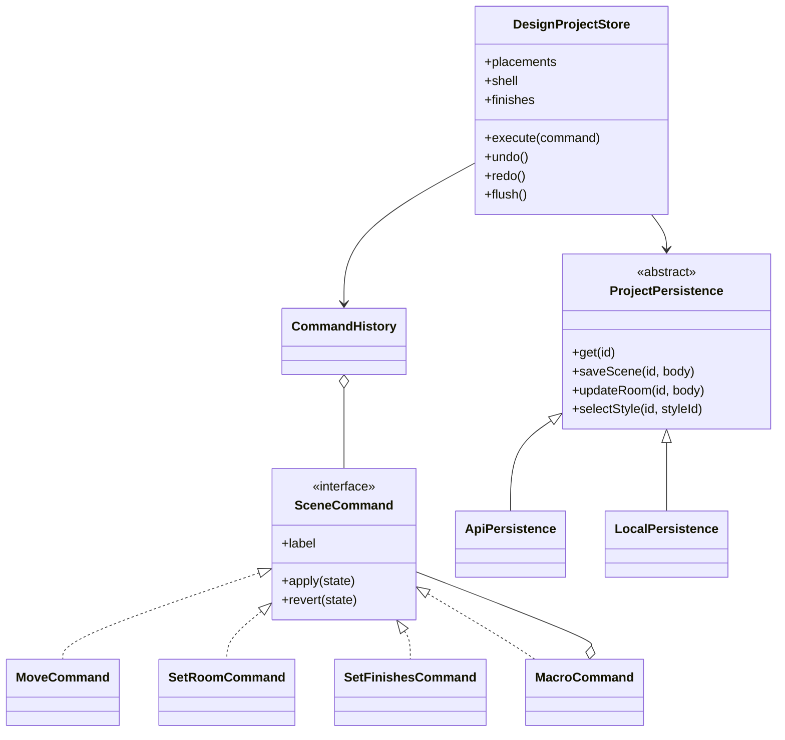
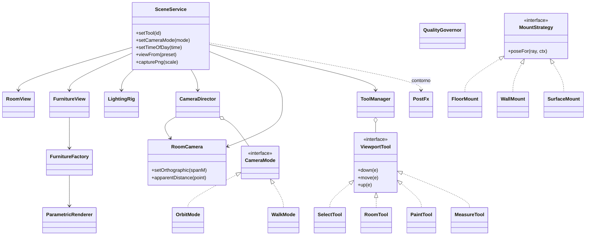
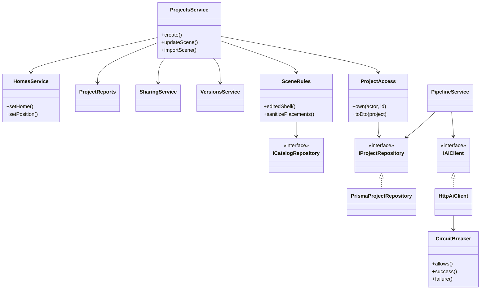
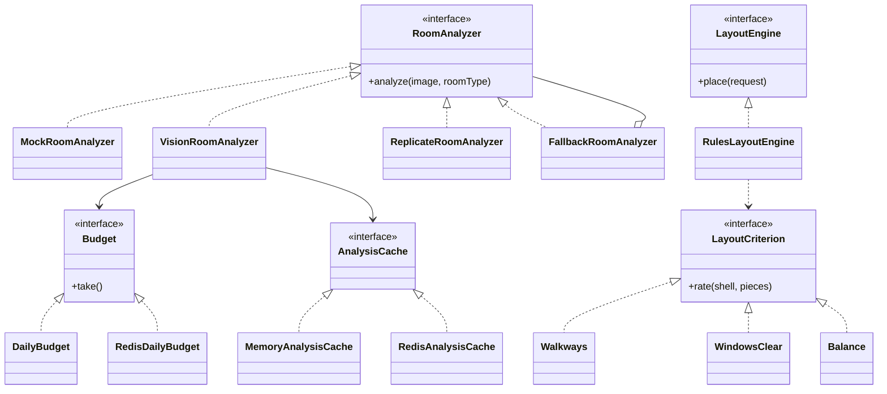
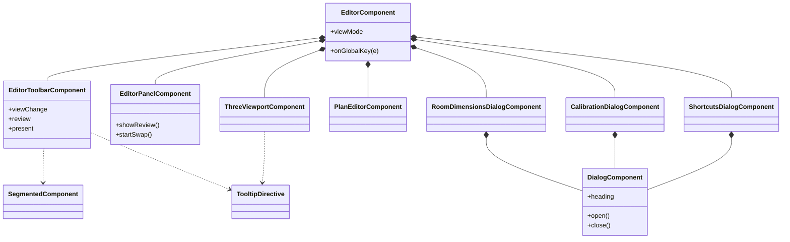
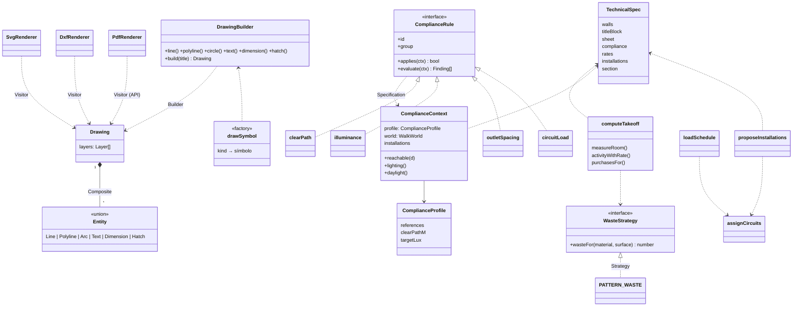
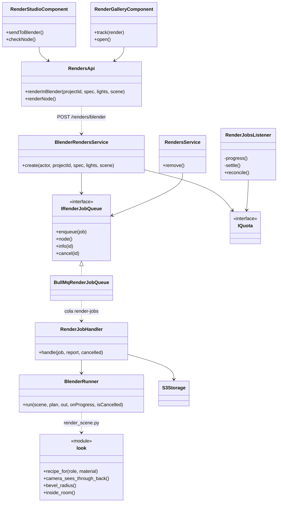

# Diagrama de clases y patrones

Las clases que sostienen el diseño, agrupadas por el patrón que aplican. No están todas: están las
que explican cómo está hecha la app. Los nombres son los del código.

## 1. Editor: estado, comandos y dónde se guarda

- **Command** — toda edición es un `SceneCommand`: por eso todo se deshace. `MacroCommand`
  (**Composite**) junta varias en un solo paso ("Otra distribución", "Vaciar cuarto").
- **Strategy** — `ProjectPersistence`: con cuenta el proyecto vive en la API; en la demo, en el
  navegador. El editor no sabe cuál usa.

## 2. Visor 3D: una fachada y sus piezas

- **Facade** — `SceneService` es la única puerta de Angular a three.js.
- **State** — `ToolManager` entrega cada gesto a la herramienta activa; `CameraDirector`, a su modo.
- **Strategy** — `MountStrategy` decide dónde cae un mueble según se apoye en el piso, la pared u
  otro mueble; `LightingPreset` (día, tarde, noche) decide cómo se ilumina.
- **Flyweight** — `ParametricRenderer` comparte geometrías y materiales entre muebles iguales.
- `QualityGovernor` baja la calidad cuando el equipo no da; `PostFx` se carga aparte.
- `RoomCamera` es una sola cámara con dos proyecciones (perspectiva y, en la vista cenital,
  ortográfica): quien la usa no necesita saber cuál está activa (ADR-0022).

## 3. Servidor: puertos y adaptadores

- **Puertos y adaptadores** — los casos de uso solo conocen interfaces (`IProjectRepository`,
  `IAiClient`, `IFileStorage`, `IJobQueue`); Prisma, HTTP, S3 y BullMQ son adaptadores.
- **Facade** — `ProjectsService` reparte en colaboradores con una sola razón para cambiar.
- **Circuit Breaker** — si la IA no responde, deja de llamarla un rato en vez de apilar esperas.

## 4. Servicio de IA: proveedores intercambiables

- **Strategy** — quién analiza la foto se elige por configuración; `LayoutCriterion` puntúa una
  distribución por partes independientes.
- **Decorator** — `FallbackRoomAnalyzer` envuelve a otro analizador y responde con el local si falla.
- **Template Method** — `VisionRoomAnalyzer.analyze`: preparar la imagen, preguntar, validar, construir.

## 5. Lógica pura compartida (`packages/shared-types`)

Funciones sin estado que usan la web, la API y las pruebas, sin navegador ni base de datos:
`decorate` (decoración), `checkDesign` (revisión), `diffScenes` (comparar versiones),
`budgetStatus` y `totalsByCategory` (presupuesto), `arrangeHome`, `snapRoom` y `shareWall` (planta
conjunta de una vivienda), `snapMove` y `arrange` (alinear), las
operaciones de `room-edit` y los esquemas zod que definen el contrato entre los tres servicios.

## 6. Interfaz: piezas base y el editor por partes

- **Composición** — el editor es el escenario y compone la barra y el panel. Estos no se conocen:
  lo que uno necesita del otro (abrir la revisión, cambiar un mueble) pasa por el editor.
- **Mediator** — por eso el editor hace de mediador entre la barra, el panel, el visor y los
  diálogos: cada pieza emite lo que quiere y el editor decide quién lo atiende.
- `DialogComponent`, `TooltipDirective` y `SegmentedComponent` son las piezas base de
  `shared/ui`: una sola implementación del título, el cierre, el foco y el teclado.

## 7. Modo Pro: dibujo técnico, normativa, obra e instalaciones (`shared-types/src/pro`)

Todo es lógica pura: la web dibuja la vista previa y calcula al momento; la API genera SVG, DXF y
PDF con el mismo código. `TechnicalSpec` (zod) es la ficha técnica que guarda cada proyecto.

El chat usa estas mismas funciones como herramientas de solo lectura de la `DesignToolbox`
(`estimate_works`, `check_compliance`, `suggest_installations`, `list_drawings`, en `pro/assistant.ts`).

## 8. Render en Blender: cola propia y nodo opcional (ADR-0036)

- **Puertos y adaptadores** — la API solo conoce `IRenderJobQueue`; BullMQ es el adaptador. El nodo
  Python no escribe en Postgres: `RenderJobsListener` (proceso worker) es quien pasa el `Render` a
  `ready` o `failed` y publica el avance.
- **Inyección del comando** — `BlenderRunner` recibe qué ejecutar; en las pruebas es un Blender
  simulado (`tests/fake_blender.py`) con la misma salida.
- **Funciones puras** — `look.py` decide materiales, luces y qué ve la cámara sin depender de `bpy`,
  así se prueba con pytest y lo usa `render_scene.py` dentro de Blender.
